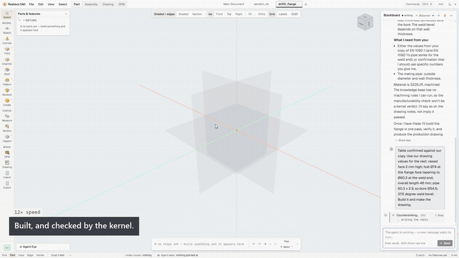

### Varun Sharma

**I build AI whose work you can check.** I'm a mechanical engineer with 13 years of hands-on CAD and physical-systems work. Now I build AI that measures its own results.

Roshera's agent builds a standard flange and draws it; the kernel re-measures every value.

| | What it is | Now |
|---|---|---|
| **[Roshera](https://github.com/varun29ankuS/Roshera-CAD)** | My main company. A CAD kernel for AI agents that certifies every result. [roshera.tech](https://roshera.tech) | Main focus |
| **[shodh-memory](https://github.com/varun29ankuS/shodh-memory)** | Memory for AI agents and robots, no LLM inside. **323★**, on crates.io, npm, PyPI and Docker | Maintained |
| **[Shodh](https://github.com/varun29ankuS/shodhRAG)** | Private document search: answers cited to the exact page, each one checked | Releasing |
| **[Saryu](https://github.com/varun29ankuS/Saryu-RNN)** | Open model research from India, now on models that drive CAD | Research |

**Monthly update:** what I built, what's next, and a question for you. [Read the latest and reply →](https://github.com/varun29ankuS/varun29ankuS/discussions/1)

**Get in touch** if you turn STEP files into drawings, train agents with verifiable rewards, or want to back verifiable AI. Reply under the update or email info@roshera.tech.

